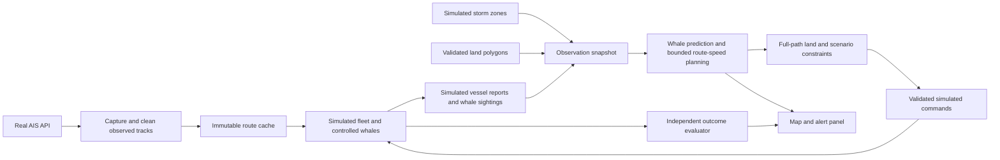

# Save the Whales — AIS-Seeded Simulation Architecture

**Implementation budget:** approximately two hours. **Training:** none. **One operating mode:** `AIS_SEEDED_SIMULATION`.

This is the authoritative build specification. Real AIS observations supply baseline route geometry for Santa Barbara; ships following those routes, whales, sightings, and the default weather field are simulated. The autonomous advisor predicts encounters and changes the simulated ships' routes/speeds. The [earlier research roadmap](Architecture.research-roadmap.md) is non-binding future reference.

## 1. Deliverable and boundaries

Build one local observation → prediction → route/speed planning → simulated execution loop with:

- A real AIS API capture/import path for Santa Barbara vessel tracks.
- Simulated copies of ships following immutable AIS-derived baseline routes.
- Controlled whales and noisy/delayed whale sightings supplied to the advisor by the simulator.
- Bounded alternative routes and speeds, evaluated for whale risk, land clearance, weather exposure, delay, distance, and the remaining factors enumerated in §8.2.
- Automatic internal alerts and application of validated changes to simulated ships.
- A Streamlit map, simple whale/weather scenario controls, and a short paired comparison.

Ship–ship interactions and maritime/international-water legality are explicitly excluded. Traffic-separation rules, protected-area regulations, and legal speed limits are not route constraints in this release. Land is a physical obstacle, regardless of the absence of legal checks. Realistic turn/stopping dynamics and bathymetric depth clearance remain deferred and are identified as unmodeled factors.

There is no real-vessel controller, outbound maritime alerting, or live whale API. All decisions affect simulated vessels only. No neural network, LLM, fitting job, GPU, or training dataset is required.

**Weather assumption for the time budget:** configurable simulated storm polygons with severity and active times, labeled as simulated. AIS is the only live data dependency. A live weather API would be an additional integration, not an unstated requirement.

## 2. Scope for the deadline

| Implement now | Defer |
|---|---|
| One AIS API adapter, bounded capture, and a small genuine AIS route cache | Multiple providers, national archives, full-port historical reconstruction |
| One simulated execution world initialized from those routes | Continuous control of actual ships or feeding real positions back into simulated motion |
| Simulated whale movement, exposure, and imperfect sightings | Whale APIs, acoustic/thermal models, animal identity tracking |
| Baseline plus a few dogleg route candidates, with up to three speeds | Global A*, Monte Carlo planning, learned policy optimization |
| Full-path land/hull-clearance checks and weather penalties | Nautical certification, depth/draft clearance, realistic maneuvering |
| One process, existing UI dependencies, small JSON/CSV artifacts | FastAPI, databases, outbox, fleet portal, repository/contract migration |
| One paired baseline/advisor comparison with visible assumptions | Seasonal campaigns or statistically significant ecological claims |

Protect AIS route ingestion, usable land geometry, whale observations, and actual rerouting. Cut playback, extra seeds, and UI polish first. Do not replace the core route planner with a speed-only demo without marking the route-change acceptance criterion unmet.

## 3. One simulation mode; source and execution stay separate

| Layer | Data and behavior |
|---|---|
| Source capture | A real AIS connection records vessel position/motion samples in the selected region. |
| Route preparation | Clean observed samples into route segments; save source timestamps, vessel metadata, quality, and provenance. |
| Scenario initialization | Freeze the chosen route bundle; spawn simulated ships and controlled whales; select the simulated weather field. |
| Advisor input | Simulated vessel state/route intent, reported synthetic whale sightings, land geometry, and declared weather forecast. |
| Execution | Recommendations change only simulated vessel routes/speeds; the baseline source tracks remain immutable. |
| Evaluation | Independent simulator truth measures encounters, modeled exposure, delay, distance, and storm exposure. |

Capture and cached-route loading are input mechanisms within the same mode, not separate live/simulated execution modes. Once a run starts, later AIS messages cannot reset ship positions, overwrite a detour, or force the ship back onto the recorded track. Newly captured tracks are available for the next run.

Use separate identifiers such as `sim:<source_mmsi>:<voyage_id>`. Preserve the real source MMSI and capture times as provenance. The original AIS timestamps describe the source track; simulated sensor observations use the virtual simulation clock. An old captured route must not make newly generated simulated reports appear stale, and simulated motion must never be labeled as the real vessel's current motion.

The baseline route is known simulation intent derived from past observations, not a prediction of a real ship's future voyage. The advisor may see that intent, but never hidden whale IDs, true dive states, or future whale trajectories.

## 4. AIS route acquisition and static inputs

### 4.1 What the AIS API actually supplies

Standard AIS reports provide position, speed, course, and related vessel/voyage fields. A complete planned waypoint route is not part of the basic message, so do not assume that `destination` is a navigable path. [US Coast Guard AIS overview](https://navcen.uscg.gov/ais-frequently-asked-questions), [AIS information specification](https://www.navcen.uscg.gov/sites/default/files/pdf/marcomms/imo/msc_resolutions/MSC69-22a1-12.pdf).

The MVP uses **observed AIS track segments as baseline routes**. It does not claim full port-to-port route intent or extend one current fix along COG and call that an actual recorded route.

### 4.2 One bounded API adapter

Use [AISStream](https://aisstream.io/documentation/) with `AISSTREAM_API_KEY` stored server-side. Subscribe to position reports and available static vessel messages for the research bounds: latitude 33.8–34.6°, longitude −120.5 to −119.0°. Follow the documented coordinate order and subscription protocol. Stream reception runs outside UI rendering, with one connection, bounded queues, reconnect backoff, and no credentials in artifacts.

AISStream is a stream source, so capture several minutes while implementing the rest of the application. Store a small JSONL/CSV file; do not wait for an entire channel passage. An already captured API-derived file can be used for fast repeat runs. Missing credentials or coverage is an explicit AIS-integration blocker. A cached genuine AIS route supports offline simulation, but a hand-drawn fixture does not satisfy the real-route requirement.

[NOAA AccessAIS](https://coast.noaa.gov/digitalcoast/tools/ais.html) can provide a later small historical extract, but is not a replacement for the requested API integration or a reason to download a national archive on the deadline.

### 4.3 Track-to-route preparation

1. Group by source MMSI and sort using a validated timestamp plus receipt order; deduplicate repeated fixes. Preserve timestamp resolution/quality.
2. Remove invalid coordinates/sentinels, clip to the region, and split at long gaps or implausible jumps. Reject a connecting chord that crosses land; do not assume a missing track section is straight and navigable.
3. Require at least three distinct positions, roughly 60 seconds of observed travel, and a configurable minimum length, initially 250 meters. Split gaps over approximately three minutes; thresholds are research configuration, not provider guarantees.
4. Preserve significant bends and endpoints. Select short clips, initially no more than 30 minutes of observed travel. If simplifying, use a small error tolerance and recheck every simplified leg against land/clearance. Keep unsimplified input and a checksum for provenance.
5. Store `route_id`, source MMSI/provider, source time range, waypoint sequence, available dimensions/SOG, validation flags, and capture checksum. Derive a simulated service speed from valid source SOG; label any assumed dimensions/speed.
6. Freeze routes before comparison. Each simulated voyage follows the selected route geometry with declared kinematics; recorded future AIS coordinates are not forced onto it after a maneuver.

One to five distinct observed segments are enough. Several simulated voyages may use the same genuine segment at different virtual entry times, with that reuse visible. Short source segments end at their last observed point; synthetic extensions are not silently added. If no usable actual segment is obtained, show `AIS_ROUTE_UNAVAILABLE`; synthetic fixtures can test code but cannot establish completion of the AIS-backed demo.

### 4.4 Land and weather inputs

Prepare a small, nonempty Santa Barbara land GeoJSON covering the mainland and relevant Channel Islands, with source/version and declared resolution. A generalized public source such as [Natural Earth land polygons](https://www.naturalearthdata.com/downloads/10m-physical-vectors/10m-land/) can support this research demo; it is not a navigation chart. Cache the regional subset rather than installing a GIS stack or repeatedly fetching it.

The current `data/land.geojson` has empty placeholder rings, and `data/lanes.json` has zero-coordinate placeholders. Neither establishes usable land geometry or actual ship routes. Validate polygon rings/bounds and visually inspect them against the AIS overlay before enabling rerouting. With missing/invalid land, return `INVALID_MAP` and do not accept detours. A baseline that fails modeled land checks must be repaired from valid source samples, trimmed, or excluded—not treated as safe because it came from AIS.

Weather is a small scenario field: polygons with severity in `[0,1]`, start/end virtual times, and optional `blocked=true` for an explicitly impassable synthetic zone. Clear configured water has severity zero. Overlapping zones use maximum severity, not an accidental sum. Stale/unknown weather is labeled unknown rather than clear. It is sufficient to support fixed polygons/active times; moving-storm prediction and wind/wave physics are deferred.

Whale APIs remain excluded following the [Whale Safe access information](https://whalesafe.com/get-involved/), [WhaleMap permissions](https://www.narwc.org/whalemap.html), and [public acoustic-feed review](https://erddap.maracoos.org/erddap/tabledap/Santa_Barbara_Channel_buoy_dmon.html). This earlier whale-data decision does not remove AIS route ingestion.

## 5. Minimal architecture



Implement small functions rather than service frameworks:

```python
capture_ais(config) -> recorded_track_file
prepare_routes(track_records, land, config) -> route_bundle
build_observation(world, reported_detections, weather, now) -> dict
predict_risk(candidate, observation) -> risk_and_costs
generate_candidates(vessel, observation) -> bounded_candidates
validate_path(candidate, observation, config) -> check_result
advise(observation) -> list[dict]
step_world(world, dt, commands) -> None
run_scenario(route_bundle, seed, policy, config) -> results
```

The advisor has no network access and imports no hidden-world state. The AIS adapter writes route inputs; it does not control the simulated fleet. Capture may continue in a background task, but each scenario consumes a frozen bundle. No real-vessel command transport exists.

## 6. Technology and installation budget

Use Python, standard-library math/JSON/CSV, and existing pandas/Streamlit/pydeck dependencies. Add one lightweight WebSocket client for AIS. Reuse small polygon/projection helpers, fixing boundary/contact behavior where needed. For land clearance, segment intersection plus point/segment-to-edge distance is enough; no general polygon-buffer engine is required.

No training, LLM, FastAPI, database, container stack, worker pool, or package migration. Keep the simulation runnable offline after the real AIS route cache and static geometry are prepared. Optional basemap tiles are decoration; a blank basemap or local plot must remain usable without the network.

## 7. Contract and units

Keep native contract **2.0**, JSON-compatible dictionaries, existing `SLOWDOWN`, `DETOUR`, and `RESUME` actions, and explicit units. Add only small optional fields needed for route provenance/weather/rejoin semantics; no v3 migration or Pydantic project.

- External coordinates are named WGS84 latitude/longitude; source/command speeds are knots; timestamps are UTC. Use one fixed local projection/origin, with explicit km↔m and knots↔distance/time helpers.
- All geometry shares the same projection, including points on both sides of longitude −120°. No per-point UTM-zone switching.
- `original_route` is the immutable AIS-derived simulated baseline; `current_route` is the simulated active path. Maintain route-progress indices separately from coordinates.
- Source MMSI/capture time and virtual sensor observation/receipt time are different concepts. Never reset simulation state from an incoming source fix.
- `static` carries land/weather-zone references; simulated forecasts/validity are explicit. The advisor sees reported whale point detections with position error, age, and source report IDs, not true animal identity/depth.
- `DETOUR` carries intermediate `detour_waypoints` and a small optional core field `rejoin_route_index`, required for new detour outputs. The referenced baseline waypoint is the explicit forward endpoint. `metadata` records explanations/costs only; execution does not depend on free-text metadata.
- Missing source dimensions use a declared conservative research default and larger uncertainty/clearance. Invalid maps, non-finite coordinates, unknown vessels, unsupported `HOLD`, expired commands, and duplicate conflicting actions are rejected visibly.

## 8. Prediction, routing factors, and selection

### 8.1 Whale prediction and multi-leg timing

For each candidate leg and recent reported sighting, align whale and vessel predictions to the same virtual interval and compute relative closest approach:

```text
r = predicted_whale_at_leg_start - vessel_at_leg_start
v = whale_velocity - candidate_leg_velocity
t_cpa = clamp(-dot(r, v) / dot(v, v), 0, leg_duration)
d_cpa = length(r + v * t_cpa)
```

Handle zero relative speed explicitly. Use a stationary whale mean if movement is unknown, with reported position uncertainty plus an age/lookahead drift allowance. Advance the assumed whale position/uncertainty to each leg's actual start time; evaluating every leg as if it begins now would be wrong.

Use a fixed watch distance/time rule and a deterministic proximity proxy, not a fabricated collision probability. Deduplicate source report IDs; maximum-over-evidence risk prevents repeated identical reports from increasing confidence. Old/missing evidence does not mean the hidden ocean is clear. Unknown whale movement and the illustrative speed-severity weight remain declared assumptions.

### 8.2 Clearly enumerated factors

Hard constraints are checked before scoring, including the connection from the current vessel position, every new leg, the rejoin, and the remaining baseline continuation. Soft costs rank only accepted candidates.

| ID | Factor | How it affects a route |
|---|---|---|
| F1 | **Land and coastal clearance — hard** | Reject any path intersecting/touching land or closer than `0.5*hypot(length_m, beam_m) + margin_m`, with the extra margin initially 100 m. Check entire segments, not just waypoints; include island boundaries, collinear contact, and rejoin/continuation. Clearance is relative to the research map's accuracy. |
| F2 | **Predicted whale proximity/exposure — primary cost and improvement condition** | Evaluate age/uncertainty-aware CPA over all timed legs, including command delay and return path. Rank lower proximity/severity proxy better; a whale-triggered detour must materially reduce modeled whale risk. Do not move from one whale threat into another to satisfy a geometric offset. |
| F3 | **Weather/storm exposure — cost; optional hard block** | Integrate maximum active severity along the timed route. More time in stormy water gives a larger penalty; otherwise equivalent clear-water routes rank better. An explicitly blocked zone rejects a path. Use simulated weather labels and validity; missing weather is not silently clear. |
| F4 | **Vessel size and speed bounds — hard** | Hull dimensions determine a conservative enclosing-circle clearance radius. Keep target speed within declared minimum/service limits. Turns/speed changes remain instantaneous research kinematics; no claim of realistic maneuverability. |
| F5 | **Travel time and delay — cost plus configured cap** | Compare ETA to the same forward rejoin/exit point for every candidate, including response delay and speed changes. Reject added delay above the configured budget, initially 15 minutes for local detours. Keep incident-level budgets fixed across replans. |
| F6 | **Extra distance — cost plus configured cap** | Penalize extra distance; initially cap the incident path at 1.5× its reference distance to the same rejoin. Do not repeatedly multiply this allowance on replans. Distance/speed are proxies, not a calibrated fuel/CO₂ model. |
| F7 | **Forward progress and route rejoin — hard** | Rejoin an explicitly identified baseline waypoint ahead of current progress. Preserve original final destination/remaining path. Reject backtracking, missing rejoins, disconnected paths, excessive waypoints, or departure from the simulation bounds. |
| F8 | **Input quality and uncertainty — gate/penalty** | Require a validated AIS-derived baseline, usable land map, sane units, and sufficiently current simulated observations/forecast. Increase uncertainty for noisy reports/default dimensions; reject unsupported precise actions rather than inventing data. |
| F9 | **Route stability — cost and update rule** | Require a minimum benefit, apply cooldown/hysteresis, and supersede queued old revisions. Penalize needless route changes; never alternate sides just because of UI refresh. |
| F10 | **Compute/forecast extent — hard budget** | Bound route templates, waypoints, speeds, and maximum time-to-rejoin. Return a budget/no-feasible result instead of silently scoring an incomplete path as safe. |

**Explicitly excluded factors:** F11 ship–ship collisions/separation and coordination; F12 COLREGs, TSS/traffic-lane legality, international/local maritime regulations and regulatory zones; F13 depth/draft/under-keel clearance; F14 realistic acceleration, turn radius, stopping distance, currents, and detailed wave response. Lane lines may be displayed as context but do not constrain detours. The region boundary is a simulation limit, not a legal boundary.

Thus "physically passable" means land-free with conservative horizontal hull clearance in this model. It does not establish real-water depth or operational safety, which is why commands remain simulated.

### 8.3 Bounded route candidates

Use the current validated plan and a forward baseline rejoin within the local lookahead (initially 15 minutes of baseline progress, or the recorded segment's end). Create at most three additional dogleg geometries: a left offset, a right offset, and one larger-offset fallback near the identified whale/weather hazard. Initial offsets can be approximately 500 m and 1,000 m, bounded by region and route-length limits.

Trigger planning for predicted whale proximity, material storm exposure/blocked weather, or an expiring/changing active maneuver. Otherwise keep the current plan. For an active detour, reserve an alternative slot for a validated forward baseline-return path instead of adding candidates beyond the cap.

A dogleg contains an approach/bypass waypoint and a departure waypoint before reconnecting to the explicit rejoin. Generate its points from the baseline direction and hazard interval, not by commanding an arbitrary heading. Full-path validation decides whether it actually clears the whale region, storm, and land. These templates need not find every possible route; global optimality and A* are not required.

Combine at most four geometries with at most three unique speeds: baseline/service, and lower configured scenario speeds such as 10 and 8 knots when valid. This caps evaluation at **12 candidates per threatened ship**. Share/copy geometry checks across speed variants. If a larger offset cannot be evaluated within the cap, report that limitation rather than expanding an unbounded search.

All candidates use the same forward endpoint and include the validated continuation. A slower/longer candidate has a later rejoin time; cap the local prediction at 60 minutes and discard candidates that cannot reach the comparison endpoint. This prevents an apparent benefit created only by pushing the threat out of the horizon.

At first planning, the reference is the AIS-derived baseline to that endpoint. For a replan while off-route, compare incremental costs with the remaining current validated path to the same endpoint; retain the incident's original distance/delay budget so successive replans cannot compound detour allowances. Final voyage metrics still compare with the original AIS-derived baseline.

### 8.4 Scoring and decision rules

After hard rejections, rank candidates with pinned, normalized engineering weights:

```text
J = w_whale * whale_risk
  + w_weather * weather_exposure
  + w_delay * normalized_added_time
  + w_distance * normalized_added_distance
  + w_change * route_change_penalty
```

`whale_risk` uses timed CPA/uncertainty and the declared illustrative speed weight, initially `(speed/service_speed)^2`. `weather_exposure = integral severity(position(t), t) dt / reference_travel_time`; compute segment–zone overlap intervals, honor active times, and use maximum severity in overlaps. Clear weather contributes zero; positive `w_weather` guarantees worse weather ranks lower when other factors match. Normalize distance/delay against the same baseline/rejoin and keep weights in configuration, not learned at runtime.

Select a route only if it improves `J` by a fixed margin and does not materially worsen whale risk. A whale-triggered maneuver must also meet a configured minimum whale-risk reduction. A weather-triggered reroute can preserve whale risk while reducing storm exposure. Show the individual cost contributions and rejection reasons so the tradeoff is reviewable.

If a slowdown wins, emit `SLOWDOWN`; if route geometry changes, emit `DETOUR` with optional speed; if a fresh assessment supports returning, emit `RESUME` with a validated forward return. Otherwise retain an unexpired valid plan. If every option including baseline violates hard constraints, return `NO_FEASIBLE_ROUTE`, pause/fail that simulated voyage visibly, and mark the run incomplete—do not call continuing into land successful avoidance.

## 9. Command validation and safe simulated rejoin

Validate IDs, source snapshot, finite coordinates/speed, validity, progress, and one action per ship. Reject rather than silently clamp/rewrite a scored action. The final validator rechecks full geometry/weather blocks even if candidate generation already did so.

A new revision supersedes pending older revisions. Apply only if still current and unexpired; revalidate the initial connection from the ship's actual simulated position after response lag. If movement makes the scored path materially stale, reject and replan. Compliance is one seeded choice per voyage/incident, not a fresh favorable draw for every repeat message.

`DETOUR` replaces only the active simulated path up to its rejoin. After reaching that waypoint, continue along the remaining immutable AIS-derived baseline; never reset to the route's first point or force later source positions. `RESUME` during a detour requires a land-free forward connection and valid weather; without one, finish the last validated path to rejoin instead of taking an unchecked shortcut.

Commands have finite leases ending at `valid_until`. Expired pending commands are canceled. For an applied slowdown, the scenario fallback restores baseline speed. For an applied detour, expiry cannot teleport the ship: restore the declared fallback speed along its remaining validated detour to the forward rejoin, then continue baseline. Recheck remaining geometry and scenario weather blocks; inability to complete fallback marks the run incomplete with a bounded diagnostic grace period. Forecast these lease/fallback rules during candidate scoring.

Only simulated ships receive commands. API records, cached source routes, and real vessels are never mutated by the advisor.

## 10. Simulator and scenario controls

Default workload: up to **5 simulated ships, 20 whales, two virtual hours**, 30-second motion steps, and 60-second advisor cadence. Short AIS segments may finish much earlier; stop when all scheduled voyages finish rather than extending tracks or running empty time. Cap initial scenarios at 10 ships, 30 whales, and six hours with a bounded 30-minute drain.

Required controls: selected AIS route IDs, virtual entry times, seed, whale count, crossing/no-threat preset, designated whale position/direction/speed or short path, and exposure setting. Add clear/stormy weather presets with one to three editable rectangular storm zones and severity. Config-only noise, latency, and response parameters are sufficient; no elaborate mid-run scene editor.

- Simulated vessels follow the cached baseline or active detour as waypoint segments. Carry leftover travel across waypoints within a tick; dimensions/service speed come from source metadata or declared defaults.
- Whales use seeded piecewise linear movement, scheduled turns, and simple exposure phases independent of ships. The operator controls scenarios, not the advisor's answer.
- The sensor model emits simulated vessel reports and imperfect whale sightings, with noise, detection probability/range, and report delay. Only due reports enter the snapshot.
- The advisor may know baseline intent and declared weather, but sees no hidden whale truth. Optional analyst truth overlays cannot enter its inputs.
- Use continuous relative-motion checks, splitting at waypoints/exposure/command events. Contact between tick endpoints must not be missed.
- Keep close-encounter rules: enter at body clearance ≤500 m; count at most one modeled contact per episode; exit only after clearance >750 m for 120 seconds. Finalize shared boundaries once and censor unfinished episodes.

All compared policies share the frozen AIS route bundle, traffic schedule, whale paths, weather field, compliance draws, and keyed sensor noise. Their vessel paths change through policy decisions. No future actual AIS fixes are injected into these worlds.

## 11. Small comparison and focused checks

Required comparison: `NO_ACTION` versus `ADVISOR` on the same AIS-derived baseline, seed, whale-crossing case, and weather field. Add a storm-detour case and a land-blocked-side case; these can be tiny deterministic fixtures. Extra policies/seeds, oracle runs, confidence intervals, and ecological calibration are deferred.

Report modeled contacts/close approaches, smooth truth-based whale exposure, storm exposure, added time/distance, alerts/route changes, rejected candidates by factor, and incomplete voyages. Keep geometric counts separate from a smooth proximity/exposure proxy; none is a count of actual deaths avoided. No-action failing a modeled hard constraint must remain visible rather than disappearing from comparisons.

Focused checks for the deadline:

1. Track preparation preserves bends/provenance, splits gaps, rejects land-crossing chords, and distinguishes a single fix from an observed route.
2. CPA aligns legs to their actual arrival times, handles zero relative speed, and detects a between-tick encounter once.
3. The advisor cannot read hidden whale truth. Identical visible inputs yield identical actions.
4. Full paths reject land crossings, touching/collinear edges, insufficient hull clearance, and an invalid return leg even if all waypoints are in water.
5. With equal whale risk/length/time, the clear-water candidate scores better; active blocked zones reject paths, and weather exposure uses arrival time.
6. After `DETOUR`, new AIS samples never overwrite simulated state; rejoin/expiry maintain forward continuous motion without resetting progress.
7. All candidates respect speed, delay, distance, bounds, and finite-work caps. Missing/placeholder maps or no feasible route produce an explicit failure.
8. A fixed route cache, seed, and weather reproduce results offline after acquisition. API connectivity/provenance is verified separately from synthetic unit fixtures.

## 12. State and recording

Keep a bounded AIS capture dictionary/queue and write only the small selected source track cache. Use in-memory simulation state, due-report queues, active episodes, and compact run artifacts. Save route/source checksum and capture range, map source/hash, seed, weather zones, planner weights, rejected factors, elapsed runtime, and completion status.

The route cache is immutable per run. Actual-source timestamps and simulated trajectory timestamps are separate. Do not log credentials. No per-tick SQLite, event-sourcing infrastructure, durable outbox, or remote API server is required. A playback slider over saved frames is stretch work.

## 13. Dashboard

One page titled **AIS-Seeded Whale Simulation**, with:

- AIS capture status, number/length/time span of usable observed route segments, source age, and cache identity.
- Route selection and simulation run/reset; simple whale and storm scenario controls.
- Actual recorded baseline geometry in one style, simulated current/detour geometry in another, land/clearance context, storm polygons, and reported whale evidence.
- Alerts containing modeled whale risk, CPA/time, proposed waypoints/speed/rejoin, cost breakdown, evidence age, and failed constraint reasons.
- A small outcome comparison including delay, extra distance, weather exposure, and modeled encounters.

Label whale/weather data as simulated and source tracks as recorded real AIS. Do not label simulated ship positions as current real positions. A land-data readiness error is visible and blocks detour acceptance. No live whale tab, vessel-control UI, or additional execution mode is needed.

## 14. Runtime caps

| Work | Initial bound / target |
|---|---|
| AIS input | One regional stream; bounded capture; typically 1–5 frozen observed segments |
| Default world | Up to 5 simulated ships × 20 whales; short route segments need not fill two hours |
| Planner | At most 4 geometries × 3 speeds = 12 candidates per threatened vessel; only relevant vessels replan |
| Route size | Small selected route bundle, initially ≤32 baseline vertices/segment with validation-preserving simplification; at most 8 detour waypoints |
| Weather | Initially 1–3 simple zones; compute overlap per segment and cache static geometry checks |
| Observations | At most 50 retained recent whale reports in an advisor call, with explicit stale/drop counters |
| Cadence | Once per 60 virtual seconds or a material new threat; no replanning on UI refresh |
| Runtime target | Default short run under 5 seconds; small paired comparison under 30 seconds, to be measured |
| Stop | Check elapsed time and stop batch computation at 30 seconds as incomplete; capture/network waits never block UI rendering |
| Training | Zero; no model weights, raw-sensor processing, seasonal campaigns, or giant data downloads |

Cache route/static-geometry checks across speed variants. Use analytic relative-motion CPA on each timed leg and segment–polygon geometry, not Monte Carlo or a dense search grid. Additional candidate count increases work; measure it rather than carrying over speed-only performance claims.

The simulation is offline/reproducible after AIS acquisition and land preparation. Lack of an AIS key/coverage/cache leaves the real-route acceptance criterion unmet; missing land leaves rerouting unmet. These are explicit data prerequisites, not reasons to invent source routes or skip land checks.

## 15. Repository changes

Reuse the current layout/contracts/helpers and add only a small AIS capture/route-preparation module plus candidate/path/weather functions where appropriate. Populate a real regional land subset and replace the use of zero-coordinate lane placeholders with the AIS route bundle. Keep source cache files separate from generated simulated trajectories.

No package renaming, v3 migration, general GIS engine, multi-provider framework, or database project. Existing intersection helpers use strict crossing tests, so verify/fix touching and collinear handling before calling them complete land validation.

## 16. Two-hour implementation order

| Timebox | Work |
|---|---|
| 0–15 minutes | Confirm AIS credentials/connection; start bounded capture in the background. Prepare/check the small nonempty land subset and route/provenance format. |
| 15–40 minutes | Freeze usable routes; spawn simulated copies and controlled whales; implement observation boundary and waypoint motion. |
| 40–75 minutes | Timed CPA, up to 12 route/speed candidates, full-path land/rejoin validation, simple storm costs, and finite command behavior. |
| 75–100 minutes | Map, route/whale/storm controls, source labels, route-change alerts, and cost breakdown. |
| 100–120 minutes | Focused land/weather/rejoin/source-separation checks, one paired comparison, runtime measurement, and fixes. |

These are implementation timeboxes, not guarantees about obtaining credentials, reception coverage, or valid geography. Begin with one real route and very small scenarios. If behind, remove animation, extra seeds, and decorative charts—not the requested AIS-backed routes, land/weather factors, or actual simulated detours. A partially working speed-only or hand-drawn-route fixture remains explicitly partial.

Completion requires verified AIS-derived route provenance, usable land geometry, simulated whale sightings into the independent advisor, at least one accepted route change in a suitable scenario, rejection of a land-crossing alternative, lower weather cost for an otherwise equivalent clear-water route, continuous forward rejoin, and bounded execution. All outcomes refer to the simulated world.

## 17. Relationship to earlier designs

[Architecture2.md](Architecture2.md) and the [research roadmap](Architecture.research-roadmap.md) are references, not current requirements. The whale API search still supports synthetic whales. The user's latest direction restores real AIS route ingestion and bounded detours, while maintaining one simulated execution mode, no training, no ship–ship checks, and no maritime-legality constraints.

The authoritative factor list is §8.2. Weather defaults to explicitly simulated storm zones for this deadline. A live weather feed, realistic dynamics/depth, and operational vessel delivery need separately scoped work; none is silently claimed by a land-free route.

## 18. Potential Problems

The following submitted concerns describe an earlier research design. They are preserved verbatim as historical notes; the updated disposition below reflects the current AIS-seeded simulation.

| ID | Sev | Hole | Failure scenario |
|---|---|---|---|
| A1 | Critical | **Compute is unbudgeted and likely infeasible.** It combines a 10 s physics step, a 30 s advisor cadence, 12–24 candidates per vessel, and Monte Carlo whale futures. A 3-month run at 10 s is ~789k ticks and ~263k decisions. | One controlled run takes hours to days in Python, so paired multi-seed evaluation never happens. |
| A2 | Critical | **Live auto-publishes detours** while geometry is placeholder and depth, ship-to-ship and manoeuvring checks are unverified (A §2.1). It also has a webhook path to real vessels. | A route through shallows or traffic reaches a bridge crew. Disclaimers don't mitigate a wrong chart. |
| A3 | High | **Scope.** Single-host product infrastructure (SQLite journal, outbox, ownership lease, planning subprocess, FastAPI with 14 endpoints, roles and auth, signed webhooks) is all required before live integration (milestone 4 comes before 5). | The team builds infrastructure for weeks before seeing a real ship on the map. |
| A4 | High | The release gate depends on an **external agreement** (Whale Safe API access, A §4) with no fallback scope. | Access is slow or denied and the release is blocked indefinitely. |
| A5 | High | Encounter counting is vague: "explicit reset/separation rules" are never defined (A §10.4). | Different implementations double count or miss counts; truth metrics can't be compared. |
| A6 | High | Truth severity is a sum over *geometric* strike events only. Those are rare (0–1 per season), so the results are zero-inflated. | Confidence intervals span zero for every policy; "a zero-strike sample is not evidence" applies to every run. |
| A7 | High | Monte Carlo forecast risk inside the planner adds sampling noise to every decision, plus heavy compute (A1). | Candidate ranking flips between cycles and hysteresis has to hide the noise. |
| A8 | Medium | A dimensionless relative risk index is specific to one model version, and alert thresholds have no anchor. | Thresholds silently change meaning when the model changes. |
| A9 | Medium | "Region-defined metric CRS" with pyproj invites UTM, but the region (120.5°W–119.0°W) **straddles UTM zones 10 and 11 at 120°W**. | Distortion or seams at the zone boundary, right through the western lanes. |
| A10 | Medium | The event journal for CONTROLLED runs persists millions of AIS-like rows to SQLite. | Simulation becomes I/O-bound. |
| A11 | Medium | Expiry semantics conflict. CONTROLLED says "applied slowdown remains until explicit resume", while recommendations expire every 5 min (§7.3 example). | An advisor crash leaves ships permanently slow, inflating delay and changing behaviour across policies. |
| A12 | Medium | A live branch samples its "hidden" whales from the **advisor's own belief model**. | It evaluates the advisor against its own assumptions (circular), contradicting A §10.5. |
| A13 | Medium | No vessel class or size filter (also D14), with a 200-vessel benchmark target. | Wasted compute on small craft. |
| A14 | Medium | Lane-corridor constraints are always on, but the TSS lanes are only ~1 NM wide. | Detours have almost no room, so the planner degenerates to slowdowns. That isn't stated, so effort goes into an A* that rarely helps. |
| A15 | Low | Contract v3 (SI units, Pydantic) and v2 (knots, km, TypedDict) are both live. | Two contracts in flight; advisor code written against the wrong one. |

### 18.1 Current disposition

| ID | Current resolution |
|---|---|
| A1 | Small AIS route bundle/world and at most 12 bounded candidates; no Monte Carlo/training; measured runtime and hard batch stop. |
| A2 | Land is mandatory before rerouting; commands affect simulated copies only. Actual maritime legality, traffic, and depth/dynamics are explicitly unverified and not operationally used. |
| A3 | One process, small capture module/cache, existing UI, and direct functions; no database/API/outbox project. |
| A4 | No whale API dependency. AIS remains a required real-data integration with explicit credentials/coverage/cache status, not fabricated source routes. |
| A5 | Fixed continuous encounter episode thresholds and between-tick checks remain; geometry is labeled a model. |
| A6 | Smooth truth-based exposure and geometric contacts are separate diagnostics; no mortality/significance claims. |
| A7 | Deterministic timed-leg CPA and fixed candidate templates; no sampling noise or trained inference. |
| A8 | Fixed distance/age rules, explicit weights/normalization, cost breakdown, and rule/config provenance. |
| A9 | One fixed local projection and unit helpers across source tracks, land, weather, and simulation. |
| A10 | Bounded source capture/cache and compact artifacts; no per-tick database persistence. |
| A11 | Finite leases, supersession, validated forward rejoin/fallback, and incomplete status when continuation fails. |
| A12 | No actual whale truth is inferred from AIS; evaluation worlds contain controlled whales. Real AIS supplies baseline intent only. |
| A13 | Limit selected source segments and simulated vessel/observation counts; disclose which routes/classes/dimensions are represented. |
| A14 | TSS legality/corridor rules are deliberately excluded. Doglegs may leave displayed lanes but must satisfy physical land/weather and configured experiment bounds. |
| A15 | One native v2 contract with only small additive provenance/weather/rejoin fields; no migration project. |
