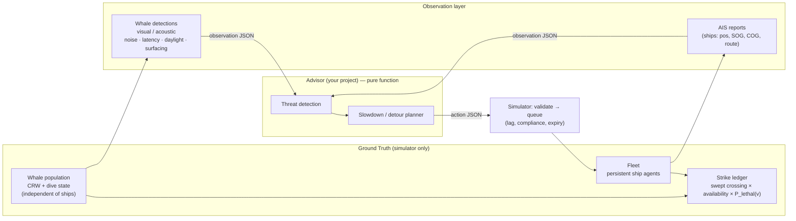

# Hackathon Blueprint v2: Whale-Ship Strike Simulator & Alerting Testbed

**Scope:** the Santa Barbara Channel, a high-risk corridor of the eastern Pacific.

This replaces `simulation_implementation_plan.md` (v1). The holes found in v1 are listed in `simulation_plan_review.md`, and each fix below points back to them as **[C1]**, **[H3]** and so on. The iteration log at the end lists the issues found *in this plan's own drafts* and how they were resolved.

---

## 1. Goal, success criteria, non-goals

**Goal.** Run a reproducible, paired A/B evaluation of whale-alert strategies. Each strategy gets the *same* ocean, the *same* whales and the *same* ships. The output is how many expected lethal strikes each strategy prevents, and what it costs in delay and fuel.

**What a good demo shows**
1. Your advisor beats **Blanket-VSR** (blanket Vessel Speed Reduction Policy), the existing voluntary 10-knot program, on strikes avoided per hour of delay. Beating "do nothing" isn't the bar. **[H4][H5]**
2. The result holds across held-out random seeds (95% CI of the paired difference excludes 0) and across reasonable values of the uncertain parameters. **[C5][M9]**
3. Same seed means same numbers, byte-for-byte.

**Non-goals.** We leave these out deliberately and state them in the pitch as assumptions:
- Ship–ship interactions and collision avoidance between ships.
- Whales reacting to ships. Whale tracks are independent of ships, which is also what makes paired comparisons possible.
- The whole Pacific.
- Live AIS ingestion.
- Ship hydrodynamics beyond speed limits and an optional acceleration cap.

> **The result is a relative comparison between strategies, not a prediction of real deaths.** Absolute numbers are only calibrated to a plausible order of magnitude. **[M6]**

---

## 2. Architecture: three layers, and the advisor never sees ground truth [C2]



**Design principles**
- **Advisor = pure function.** `advise(observation: dict) -> list[dict]`. The input is a JSON round-tripped copy, so the advisor can't mutate simulator state **[H6]**. The same function can later sit behind HTTP unchanged.
- **Baselines are advisors too.** No-Action, Blanket-VSR and Oracle all go through the same contract, validation and compliance path, so the comparison is apples-to-apples.
- **Ground truth never crosses the boundary.** The only exception is the Oracle scenario, which is labelled as an upper bound.

---

## 3. Scope tiers: build the MVP first

The v2 design is bigger than v1, and a 36-hour hackathon can't absorb all of it. Everything is tiered. **MVP is the defensible minimum**; stretch items only start once the MVP comparison runs end to end.

| Area | MVP (must have by hour ~18) | Stretch |
|---|---|---|
| Geometry | Local XY projection, hand-drawn land polygons, 2 TSS lanes (each direction), VSR zone polygon | Natural Earth coastline import |
| Ships | Synthetic voyage schedule (Poisson arrivals, 3 ship classes), waypoint following, persistent fleet | Schedule derived from pre-filtered MarineCadastre AIS; acceleration cap |
| Whales | One species (blue), correlated random walk biased to a hand-drawn hotspot density grid, 3-state dive cycle | Density grid from OBIS-SEAMAP/Happywhale sightings; humpback and fin parameter sets; seasonal arrivals |
| Strikes | Swept crossing check, Gaussian jitter kernel, availability, V&T lethality, expected-value ledger | Monte Carlo sampled-strike mode for a "what actually happened" demo replay |
| Sensors | Ship-based visual detection (surface + daylight + range + p), position noise, report latency | Fixed acoustic buoy(s) giving zone-level presence with hours of latency |
| Compliance | Per-voyage comply/ignore draw | Response lag distribution; different compliance for voluntary vs real-time alerts |
| Metrics | Expected lethal strikes, close approaches, delay, extra NM, alerts per transit, invalid commands | Fuel/CO₂ proxy, lane-departure minutes, sensitivity sweep |
| Eval | 4 scenarios × 5 paired seeds, mean ± 95% CI | 20+ seeds, multiprocessing, cost-effectiveness frontier plot |
| Demo | Static matplotlib/pydeck map of one run + scoreboard table | Streamlit replay with a time slider (`TripsLayer`) |

---

## 4. Framework: pure Python, standard library first

Keep v1's choice: dataclasses, `math` and `json`. Optionally add `pandas` for CSVs and `streamlit`/`pydeck` for the demo. Two changes in rationale **[L3][L4]**:
- **No haversine in inner loops.** Project every position once into a local tangent plane in km, centred on 34.2°N, 119.75°W:
  `x = R·Δλ·cos φ₀`, `y = R·Δφ`. The scale error is under 0.5% at the box edges, which is about 1 m on a 200 m ship–whale distance. Swept closest-approach maths then becomes plain 2-D vector algebra. Haversine is kept only for reporting and tests.
- **No persistent spatial index.** A uniform grid (`dict[(ix, iy)] -> list[whale_id]`, 5 km cells) is rebuilt every tick in O(n_whales). There's nothing to keep in sync, which is v1's STRtree concern solved trivially.

Measured on this laptop: pure-Python haversine runs at about 820k calls/s. The performance budget is in §8.

---

## 5. World model (simulator side)

### 5.1 Domain & geometry
- **Bounding box:** 33.8°N–34.6°N, 120.5°W–119.0°W (lon −120.5 to −119.0). **[L1]**
- **Land polygons** (`data/land.geojson`): mainland coast plus San Miguel, Santa Rosa, Santa Cruz and Anacapa islands, each hand-simplified to 10–30 vertices.
- **Geometry functions:** point-in-polygon by ray casting, and segment–polygon intersection by edge-crossing tests. All pure Python, in `simulator/geo.py`.
- **Lanes** (`data/lanes.json`): northbound and southbound TSS lane centrelines as waypoint lists, with entry/exit "gates" at the box edge.
- **VSR zone** (`data/vsr_zone.geojson`): one polygon covering the TSS, used by the Blanket-VSR baseline.
- All coordinates must be **verified against NOAA chart data before the pitch**. During the hackathon, approximate coordinates are fine.

### 5.2 Time
- **Physics tick** `dt = 5 min` (configurable). Swept checks make this safe **[C1]**.
- **Decision interval** `decision_dt = 15 min`: how often the advisor is called **[M10]**.
- **Run window:** `start_date` (default **1 July**, in whale season **[M1]**) plus `months`, then a **drain period** after `end_time`. During the drain no new ships spawn, but the simulation keeps running until every ship in transit has exited **[H2]**.
- All timestamps are UTC ISO-8601 with `Z`. The daylight window is evaluated in local time (America/Los_Angeles).

### 5.3 Whales: synthetic ground truth [C3][M3]
- **Abundance** `N(month)` comes from config (e.g., peaks Jul–Sep). The MVP uses a constant N for the run.
- **Density surface:** a 2 km grid of relative density. The MVP uses 2–3 hand-drawn Gaussian hotspots along the shelf break and lanes. In stretch, it's a kernel-density estimate of cached sightings. Note that sightings are effort-biased; we accept that and state it.
- **Movement:** a two-state correlated random walk.
  - FORAGING: about 1 km/h with high turning.
  - TRANSITING: about 5 km/h, directed.
  - Markov switching between the two states.
  - A small drift up the density gradient.
  - Reflection off land and the box edges.
- **Dive cycle:** a per-whale semi-Markov chain over SURFACE → SHALLOW → DEEP, with configurable durations. Availability `a(state)` is 1.0 for SURFACE, `p_shallow` for SHALLOW and 0 for DEEP. This gives *correlated* availability over minutes, unlike v1's independent 15% flip.
  - Default durations are placeholders and must be checked against blue-whale dive literature before quoting.
- **Determinism:** every whale has its own `random.Random` stream seeded from `(seed, "whale", whale_id)`. Whale stepping never reads ship state. As a result, **whale trajectories are identical across scenarios for a given seed** **[C5]**. That holds even when scenarios differ in drain length, because the stepping is identical as far as the shorter run goes.

### 5.4 Ships: persistent agents [H1][M7][M4]
- **Voyage schedule** (identical across scenarios). Each voyage has:
  - `voyage_id`, `ship_id` (MMSI-like) and class (container / tanker / bulk)
  - `length_m`, `beam_m`
  - `service_speed_kn` (container 18–22, others 12–15)
  - `entry_time`, `route` (lane waypoints from entry gate to exit gate)
  - `complies` (a bool, drawn per voyage)

  The MVP generates it from Poisson arrivals at a configurable rate per lane direction. In stretch it's derived from pre-filtered AIS.
- **Fleet registry:** a ship spawns at `entry_time` and despawns when it reaches its exit gate. Its state persists across ticks: position, current route, active command and speed.
- **Kinematics:** move along the current route at `min(commanded, service)` speed. When a waypoint is passed mid-tick, the remaining distance carries onto the next leg, and the tick is split into **sub-segments** (needed by §5.5). Speed changes take effect at the start of a tick; the optional acceleration cap is stretch.
- **Speed bounds:** `min_speed_kn = 6` (steerage) and `max = service_speed_kn`.

### 5.5 Strike model: swept, deduplicated, expected-value [C1][C4][C5][M2][M5]
In each tick, for each ship sub-segment `p0 → p1` and each whale `w0 → w1` near the segment's bounding box, with margin `m = 4σ + w + whale drift per tick`. That's about 1.3 km at σ = 300 m and 4.2 km at σ = 1 km. A fixed 1 km margin would truncate the kernel at large σ.

1. Relative position `r(τ) = (w0 − p0) + ((w1 − w0) − (p1 − p0))·τ` for τ ∈ [0, 1). Let ĥ be the ship heading unit vector and n̂ its left normal.
2. **Crossing event:** the along-track coordinate `s(τ) = r(τ)·ĥ` goes from ≥ 0 to < 0 inside [0, 1), meaning the whale passes from ahead of the bow to astern. Solve for τ\*. Using a half-open interval means **each pass is counted exactly once**, even across tick or sub-segment boundaries.
3. **Lateral miss** `d = r(τ*)·n̂`, and hull half-width `w = beam/2 + whale_length/2` (about 32 m for a 40 m beam and a 25 m blue whale).
4. **Jitter kernel:** the whale's true position is only known to about σ (default 300 m) because the movement model is coarse, so
   `P_path = Φ((w − d)/σ) − Φ((−w − d)/σ)`, with Φ from `math.erf`.
   This equals averaging over Gaussian lateral jitter. It turns a 0/1 event that happens once a season into a smooth expected value with far lower variance. σ is in the sensitivity sweep.
5. **Expected lethal strikes** `+= a(whale_state at τ*) × P_path × P_lethal(v_ship)`, where
   `P_lethal(v) = 1 / (1 + exp(−(−4.89 + 0.41·v)))`.
   Reference values: **8.6 kn → 0.20, 10 kn → 0.31, 12 kn → 0.51, 15 kn → 0.78, 20 kn → 0.97**.
   This is P(lethal | strike), not P(strike).
6. Also log **expected strikes** (without P_lethal) and **close approaches**: a crossing with |d| < 500 m, counted per ship-whale pair per pass. This is v1's encounter radius, renamed.

**Calibration [M6].** Tune `N`, `p_shallow` and σ once, on dev seeds only. The target is No-Action expected lethal strikes per summer–fall season in a plausible order of magnitude for this region. For context, Rockwood et al. 2017 estimated roughly 18 blue-whale ship-strike deaths per year across the entire U.S. West Coast EEZ; verify this before quoting it. After calibration, freeze the parameters.

### 5.6 Observation model: what the advisor sees [C2]
- **Ships (AIS-like):** `ship_id`, position, SOG, COG, `length_m`, `beam_m`, `original_route` (remaining lane waypoints), `current_route`, `active_command`. This counts as known voyage-plan information, so it's realistic.
- **Whale detections, MVP visual model:** each tick, a whale can be detected by any ship within `r_visual` (3 km) when all of these hold:
  - the whale is in SURFACE state
  - it's daylight (local 06:00–20:00 in summer; configurable)
  - a draw with probability `p_detect` (0.5) succeeds

  Each detection carries Gaussian position error `σ_obs` (200 m) and is reported after a latency of `U[0, 30]` min.
- **Stretch, acoustic buoy:** a fixed location (config) detects whales within 15 km with some probability. It reports *zone-level* presence (buoy id + radius) with 1–6 h latency.
- **Detection record format:**
  ```json
  {"detection_id": "d_000123", "species": "blue", "lat": 34.21, "lon": -119.93,
   "position_error_m": 200, "observed_at": "2024-07-15T14:05:00Z",
   "reported_at": "2024-07-15T14:22:00Z", "source": "visual:MMSI_367123450"}
  ```
  There's **no whale id**: deduplication is the advisor's job. The observation contains every detection with `reported_at` in the last 24 h.
- **Randomness:** sensor draws use **counter-based randomness**, a stable hash of `(seed, "sensor", whale_id, tick, ship_id)` mapped to a uniform value. One scenario's ships moving differently therefore doesn't shift the random sequence for another scenario's draws.
- **Oracle mode:** the same schema, but every whale is reported each tick at its exact position with zero latency, plus its dive state. This gives an upper bound only.

### 5.7 Command validation & lifecycle [H3][H6]
On every advisor call the simulator validates each action. **Invalid actions are rejected, logged and counted; they never crash the run.**

| Check | Rule |
|---|---|
| `ship_id` | Must be active |
| `command` | One of `SLOWDOWN`, `DETOUR`, `RESUME` (`HOLD` is accepted as a deprecated alias of `RESUME`) **[L6]** |
| `target_speed_knots` | Clamped into `[min_speed, service_speed]`; a value outside the range is logged as a warning |
| `detour_waypoints` | 1–8 points, all inside the bbox and not on land |
| Full new path | ship position → detour waypoints → **rejoin** must not intersect land. The rejoin is computed by the simulator: the first original-route waypoint ahead whose leg from the last detour point is land-free. If none exists, reject. |
| Deviation cap | New path length ≤ 1.5 × the remaining original length |
| Duplicates | More than one action for the same ship in a call: the last one wins, and a warning is logged |

**Lifecycle**
- An accepted command is queued. It takes effect after the ship's response lag (MVP: 0; stretch: drawn per voyage) and only if `complies` is true. Non-compliant ships log "ignored".
- Each command lasts until `valid_until` (default `issued_at + 60 min`, max 6 h). After that the ship reverts to its original route and service speed. Re-issuing extends it.
- `RESUME` reverts immediately.
- If a command arrives while a ship is mid-DETOUR, it **replaces** the active one. A DETOUR + speed applies both.
- **DETOUR expiry rule:** when a DETOUR's `valid_until` passes, the ship heads to its rejoin waypoint rather than jumping back onto the lane. The rejoin leg was already validated, so that's safe.

---

## 6. The contract (freeze this at hour 2) [H6]

### 6.1 Input: `observation`
```json
{
  "schema_version": "2.0",
  "now": "2024-07-15T14:30:00Z",
  "decision_interval_min": 15,
  "bbox": {"lat_min": 33.8, "lat_max": 34.6, "lon_min": -120.5, "lon_max": -119.0},
  "static": {"land": "<geojson ref>", "lanes": "<ref>", "vsr_zone": "<ref>"},
  "ships": [
    {"ship_id": "MMSI_367123450", "lat": 34.18, "lon": -119.62, "sog_knots": 18.2,
     "cog_deg": 285.0, "length_m": 300, "beam_m": 40, "service_speed_knots": 19.0,
     "original_route": [{"lat": 34.20, "lon": -119.90}, {"lat": 34.25, "lon": -120.30}],
     "current_route":  [{"lat": 34.20, "lon": -119.90}, {"lat": 34.25, "lon": -120.30}],
     "active_command": null}
  ],
  "whale_detections": [ { "...": "see §5.6" } ]
}
```
`static` is sent in full on the first call and by reference after that. The advisor may cache it.

### 6.2 Output: `actions` (a list; an empty list means "no change")
```json
[
  {
    "ship_id": "MMSI_367123450",
    "issued_at": "2024-07-15T14:30:00Z",
    "command": "DETOUR",
    "target_speed_knots": 10.0,
    "detour_waypoints": [{"lat": 34.250, "lon": -119.850}, {"lat": 34.310, "lon": -119.720}],
    "valid_until": "2024-07-15T15:30:00Z",
    "metadata": {"reason": "Blue whale detection 3.8 NM ahead", "threat_level": "HIGH",
                 "projected_delay_minutes": 12.5, "route_risk_score": 0.89}
  }
]
```
`metadata` is logged, never interpreted. `projected_delay_minutes` is compared with the realized delay as a bonus "forecast accuracy" stat.

### 6.3 Runtime rules
- `advise()` gets about **20 ms per call** as a target; time is measured and reported **[M10]**. A hard timeout is stretch (it needs a subprocess). Over budget means a warning, not failure.
- Advisor code imports **only** from `contract/` and its own package, never from `simulator/`. A test enforces this by scanning imports.

---

## 7. Engine loop (corrected)

```python
def run(scenario: Scenario, cfg: Config, seed: int) -> Summary:
    world    = World.load(cfg)                    # land, lanes, VSR zone, projection
    whales   = WhalePopulation(cfg, seed)         # per-whale RNG streams; never reads ships
    voyages  = VoyageSchedule.build(cfg, seed)    # identical for every scenario
    sensors  = SensorSuite(cfg, seed)             # counter-based randomness
    advisor  = scenario.make_advisor(cfg)         # NoAction / BlanketVSR / Yours / Oracle
    fleet, ledger = Fleet(world), Ledger()

    t, end, tick = cfg.start, cfg.start + cfg.duration, 0
    while t < end or fleet.active:                # drain: let in-transit ships finish  [H2]
        if t < end:
            fleet.spawn_due(voyages, t)
        sensors.observe(t, whales, fleet)         # queue detections with latency

        if tick % cfg.ticks_per_decision == 0 and fleet.active:
            obs = build_observation(t, world, fleet, sensors.reported_by(t),
                                    oracle=whales if scenario.oracle else None)
            actions = timed_call(advisor.advise, json_roundtrip(obs), ledger)
            for a in actions:
                fleet.submit(validate(a, world, fleet, t), t, ledger)   # reject ≠ crash

        fleet.apply_due_commands(t)               # lag, compliance, expiry → revert/rejoin
        w0 = whales.positions_and_states()        # snapshot at t
        whales.step(cfg.dt)                       # independent of ships
        grid = whales.grid(cell_km=5)             # rebuilt each tick, nothing to sync
        for ship, seg in fleet.step(cfg.dt):      # sub-segments split at waypoints
            for wid in grid.query(seg.bbox(margin_km=cfg.margin_km)):   # 4σ + w + drift
                strike.accumulate(ship, seg, w0[wid], whales.pos[wid], ledger)
        fleet.despawn_arrived(ledger)             # records transit time per voyage
        t += cfg.dt; tick += 1

    return ledger.summary()
```

`strike.accumulate` interpolates the whale between `w0` and its new position over the sub-segment's time span, so a sub-segment that covers only part of a tick uses the matching fraction of whale motion.

---

## 8. Metrics, evaluation & performance [H4][H5][C5][M9]

### 8.1 Scenarios (all go through the same contract)
1. **No-Action**: returns `[]`.
2. **Blanket-VSR**: every ship that is inside the VSR zone, or will enter it before the next decision, gets `SLOWDOWN 10 kn`, re-issued while it's in the zone. On exit the ship gets `RESUME`. Compliance is the same draw as for the advisor.
3. **Your Advisor**.
4. **Oracle** (optional): your advisor fed oracle observations. This shows how much of the gap comes from sensing and how much from decision logic.

### 8.2 Per-scenario metrics
| Metric | Definition |
|---|---|
| **Expected lethal strikes** (primary) | Σ from §5.5 |
| Expected strikes | Same, without P_lethal |
| Close approaches | Crossings with \|d\| < 500 m |
| Delay hours | Σ over voyages of (actual transit time − original route length ÷ service speed) |
| Extra distance | Σ (sailed NM − original route NM) |
| Fuel proxy (stretch) | Σ v²·distance per leg, relative to No-Action (power ∝ v³, time ∝ 1/v) |
| Alerts per transit | Accepted commands ÷ voyages (alert-fatigue proxy) |
| Invalid / ignored commands | Counts |
| Lane-departure minutes (stretch) | Time spent outside the TSS polygons |
| Advisor latency | p50 / p95 ms |

**Headline:** the reduction in expected lethal strikes vs **Blanket-VSR**, together with the change in delay hours, shown as a point on a strikes-vs-delay plot alongside the other scenarios. Present it as a percentage, with fractional expected values shown honestly (e.g., "0.42 → 0.19 expected deaths/season").

### 8.3 Statistics
- **Seeds:** dev seeds 0–9 for tuning and calibration; **eval seeds 100–119, held out** for the pitch.
- For each eval seed, run all scenarios. Report the mean and 95% CI of the **paired difference** (Your Advisor − Blanket-VSR), using a t-interval over seeds.
- **Sensitivity sweep (stretch):** σ ∈ {100, 300, 1000} m, `p_detect` ∈ {0.25, 0.5, 0.8}, compliance ∈ {0.5, 0.8, 1.0}. The pitch claim should hold across the sweep.

### 8.4 Performance budget
Each line below is an assumption; measure it in hour ~10 with the stub advisor.
- **Ticks:** a 3-month run at dt = 5 min is 25,920 ticks plus about 100 drain ticks.
- **Concurrent ships:** about 5–15 (a ~130 km transit at 14 kn takes about 5 h).
- **Whales:** 50–300.
- **Candidate pairs:** with the grid, about 1–3 per ship per tick, so roughly 10⁶ swept checks per run. That's seconds.
- **Advisor calls:** 8,640 per run at 15-min decisions. At 20 ms that's about 3 min; at 2 ms it's about 17 s.
- **Full eval:** 4 scenarios × 20 seeds = 80 runs. Use `multiprocessing.Pool` across CPU cores, plus a `--quick` mode (1 week, 1 seed, under 30 s) for the inner dev loop.
- **Trajectory log:** for the demo replay only, write positions every 15 min for one chosen seed to `runs/<id>/trajectories.csv`. Don't log all 80 runs **[M8]**.

---

## 9. Testing (pytest, written alongside the code) [H7]

| Test | Asserts |
|---|---|
| Projection | XY distance vs haversine is within 0.5% across the bbox |
| Lethality | `P(10) ≈ 0.312`, `P(15) ≈ 0.779`, `P(20) ≈ 0.965` |
| **Tunnelling regression** | A ship at 15 kn passes a stationary SURFACE whale dead ahead mid-tick. Expected strikes == `Φ(w/σ) − Φ(−w/σ)`, not 0 |
| Dedup | A whale crossing exactly at a tick or sub-segment boundary is counted once |
| Waypoint carry-over | A ship that passes a waypoint mid-tick ends at the correct distance along the next leg |
| Land | Known island points test inside; a detour across Santa Cruz Island is rejected |
| Validation | Unknown `ship_id` → rejected, run continues; speed 30 → clamped |
| Expiry | A DETOUR expires, then the ship follows the rejoin leg and the route resumes |
| **Determinism** | Same seed + scenario gives identical summary JSON |
| **Paired invariant** | Hashes of whale trajectories over the first `end` ticks are identical across all 4 scenarios |
| No-Action sanity | Delay == 0 and extra NM == 0 |
| Conservation | Every spawned voyage despawns |
| Isolation | Advisor package has no `simulator` imports, and mutating `obs` doesn't affect the sim |

---

## 10. Directory structure

```
Save-The-Whales/
├── README.md
├── requirements.txt            # pandas, pytest; demo extras: streamlit, pydeck, matplotlib
├── config/
│   └── default.json            # all tunables (dt, N, σ, p_detect, compliance, seeds...)
├── data/
│   ├── land.geojson            # simplified coast + Channel Islands
│   ├── lanes.json              # TSS centrelines + entry/exit gates
│   ├── vsr_zone.geojson
│   ├── whale_density.json      # MVP: hotspot params; stretch: KDE grid from sightings
│   └── raw/                    # (stretch) pre-filtered AIS & sightings, git-ignored if large
├── contract/                   # shared by both subteams — frozen at hour 2
│   ├── schema.py               # TypedDicts for observation & action, schema_version
│   └── examples/               # sample observation.json / actions.json
├── simulator/
│   ├── geo.py                  # projection, point-in-polygon, segment intersection
│   ├── whales.py               # CRW movement, dive state, per-whale RNG
│   ├── ships.py                # voyage schedule, Fleet, kinematics, sub-segments
│   ├── sensors.py              # visual (MVP), acoustic (stretch), counter-based RNG
│   ├── strike.py               # swept crossing, jitter kernel, lethality
│   ├── commands.py             # validation, queue, lag/compliance/expiry, rejoin
│   ├── engine.py               # main loop (§7)
│   ├── metrics.py              # ledger + summary
│   └── baselines.py            # NoAction, BlanketVSR, Oracle wrapper
├── your_project/               # Subteam B — may import only from contract/
│   ├── detector.py             # detection clustering/dedup, CPA/TCPA vs ship tracks
│   ├── router.py               # slowdown vs detour choice, land-aware waypoints
│   └── advisor.py              # advise(observation) -> actions
├── tests/
├── run_comparison.py           # scenarios × seeds → results.json + CI table (--quick)
└── app.py                      # demo: replay one run + scoreboard
```

---

## 11. Timeline

| Hours | Subteam A (Simulator) | Subteam B (Advisor) | Joint gate |
|---|---|---|---|
| **0–2** | Write `contract/schema.py` + example JSONs **together** | Same | ✅ Contract frozen; stub `advise()` returns `[]` |
| 2–8 | `geo.py` (projection, land, lanes), `ships.py` (Fleet, kinematics), `strike.py` + tunnelling/lethality tests | `detector.py` against example observations: dedup detections, project ship tracks, TCPA/CPA | ✅ `run_comparison.py --quick` runs No-Action end to end |
| 8–14 | `whales.py` (CRW + dive), `sensors.py` (visual), `commands.py` (validation, lifecycle), Blanket-VSR baseline | `router.py`: SLOWDOWN-first policy; DETOUR only when land-safe; use `validate()` locally to self-check | ✅ First 4-scenario × 5-seed table (on dev seeds) |
| 14–20 | Calibration on dev seeds, freeze params; determinism + paired-invariant tests; perf measurement | Tune on dev seeds against Blanket-VSR; keep alerts per transit low | ✅ **MVP complete**: CI table on eval seeds |
| 20–30 | Stretch: AIS-derived schedule, acoustic buoy, sensitivity sweep, multiprocessing | Stretch: buoy-aware logic, smarter detours, Oracle gap analysis | ✅ Code freeze at hour 30 |
| 30–36 | Demo replay app + strikes-vs-delay plot | Slides: problem → method → **paired, held-out** results → limitations | Rehearse with numbers from eval seeds only |

**Pre-hackathon checklist** (allowed prep, or do it in the first hour):
- Draw the land, lane and VSR polygons.
- Optionally pre-filter one month of MarineCadastre AIS to the bbox; the national daily files are large.
- Pull the sightings CSV.

Every dataset has a synthetic fallback, so no one is blocked waiting on downloads.

---

## 12. Assumptions & limitations (say these in the pitch)

1. Whales don't react to ships.
2. There are no ship–ship interactions, and speed changes are instant at tick granularity.
3. The strike model is hull-path crossing × dive availability × the V&T 2007 lethality curve (P(lethal | strike)). The jitter σ and the dive parameters are tunable and covered by the sensitivity analysis.
4. The whale distribution is synthetic. In stretch it's informed by effort-biased sightings, so it isn't a population estimate.
5. Absolute death counts are calibrated only to an order of magnitude; **claims are relative**.
6. Coordinates and literature figures are approximate during the build and must be verified before the pitch.

---

## Appendix A: Iteration log (holes found in this plan's own drafts)

**Iteration 1.** Fix the v1 review findings C1–C5, H1–H7, M1–M10 and L1–L6 (see `simulation_plan_review.md`).

**Iteration 2.** I re-read the v2 draft adversarially:

| # | Hole in the draft | Resolution |
|---|---|---|
| I2.1 | **Scope creep.** The draft was too big for 36 h. | Added the §3 MVP/stretch tiers, MVP gate at hour ~20 and code freeze at 30. |
| I2.2 | A hard 32 m strike width plus explicit whales still gives 0/1 events per season, so CIs would be useless. | Added the Gaussian lateral-jitter kernel (§5.5, step 4), equivalent to averaging over position uncertainty. σ goes in the sensitivity sweep. |
| I2.3 | Counting "CPA within a tick" double counts passes whose closest point falls on a tick boundary. | Redefined the event as the along-track coordinate changing sign over a half-open τ interval, so each pass counts once. Added a boundary test. |
| I2.4 | Delay measured against the No-Action run makes scenarios depend on each other. | Delay is now measured against the analytic ideal (route length ÷ service speed). No-Action delay is 0 by construction and is tested. |
| I2.5 | The drain period gives scenarios different run lengths, so the shared whale RNG could desync. | Per-whale streams make the shared prefix identical. The paired-invariant test checks only the first `end` ticks. |
| I2.6 | Ship-based visual sensors depend on ship positions, so sequential RNG would desync across scenarios. | Counter-based randomness keyed on `(seed, whale, tick, ship)` (§5.6). |
| I2.7 | Precomputing all whale tracks costs about 90 MB (300 whales × 26k ticks × 3 floats). | Step whales on the fly from per-whale RNG streams. They're still deterministic and still independent of ships. |
| I2.8 | When a DETOUR expires, the ship would jump back onto the lane, possibly across land. | Expiry routes the ship through the already-validated rejoin leg (§5.7). |

**Iteration 3.** Re-read again:

| # | Hole | Resolution |
|---|---|---|
| I3.1 | The advisor could import simulator internals (whale RNG, positions), which is cheating by accident. | Import-scan test and contract-only imports (§6.3, §9). |
| I3.2 | Tuning and calibrating on the pitch seeds would overstate gains. | Dev seeds 0–9 vs held-out eval seeds 100–119 (§8.3). |
| I3.3 | Blanket-VSR with perfect compliance vs an advisor with partial compliance would be an unfair comparison. | The same per-voyage `complies` draw applies to every scenario (§8.1). |
| I3.4 | A DETOUR whose waypoints are fine but whose path to the rejoin crosses an island would slip through. | Validation checks the *full* path: ship → waypoints → rejoin (§5.7). |
| I3.5 | A sub-segment shorter than a tick paired with the whale's full-tick motion would misplace the whale. | `accumulate` interpolates the whale over the sub-segment's own time span (§7 note). |
| I3.6 | An "Oracle" with the same schema but no dive state can't separate sensing value from logic value. | The Oracle observation includes dive state (§5.6). |

**Iteration 4.** I prototyped §5.5 (scratchpad `proto.py`) to check it actually works:
- The tunnelling regression matches `Φ(w/σ) − Φ(−w/σ)` exactly.
- A crossing at a tick boundary is counted once.
- Over 20,000 random moving-whale passes, none was counted other than exactly once.
- Throughput is about 435k swept checks/s, so the §8.4 budget holds.

| # | Hole | Resolution |
|---|---|---|
| I4.1 | The fixed 1 km query margin truncated the jitter kernel. At σ = 1 km, a whale 1 km off-track still carries 60% of the peak P_path. | Margin is now `4σ + w + drift` (§5.5, §7). |
| I4.2 | `t % decision_dt` on datetimes is ill-defined. | Use an integer tick counter (§7). |
| I4.3 | Blanket-VSR reacting only to ships already in the zone lets a ship run at full speed for up to 15 min inside it. | Issue on predicted entry before the next decision; RESUME on exit (§8.1). |

**Iteration 5.** No further *glaring* issues found. Known residual risks, accepted and stated:
- Dive and density parameters are placeholders until checked against the literature.
- Synthetic whale distribution.
- Statistical power depends on σ and seed count; the sensitivity sweep covers this, and `--quick` keeps iteration fast.
- The 20 ms advisor budget is soft without a subprocess timeout.
